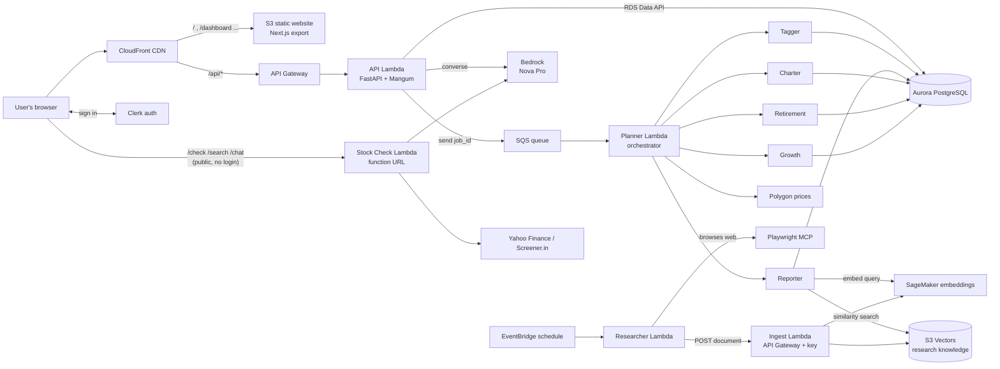
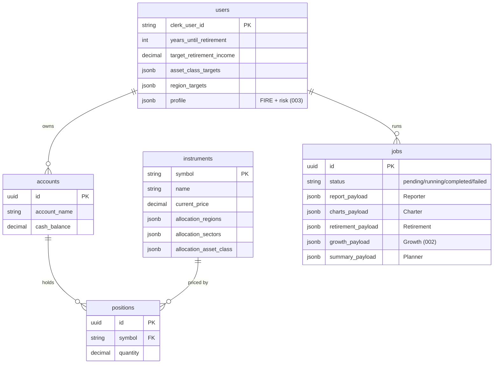
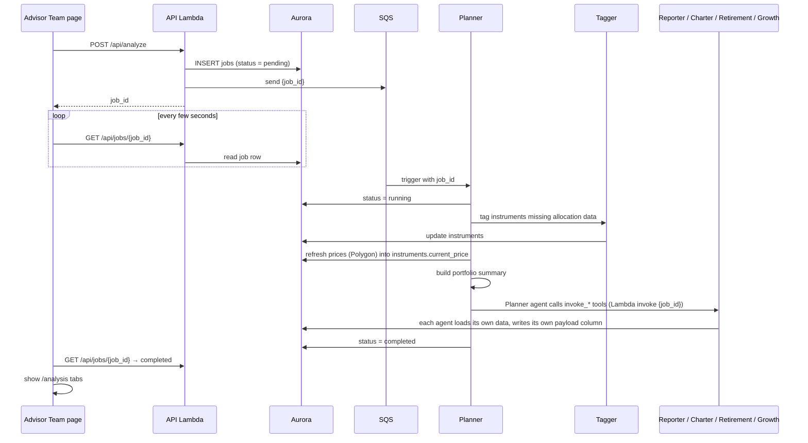
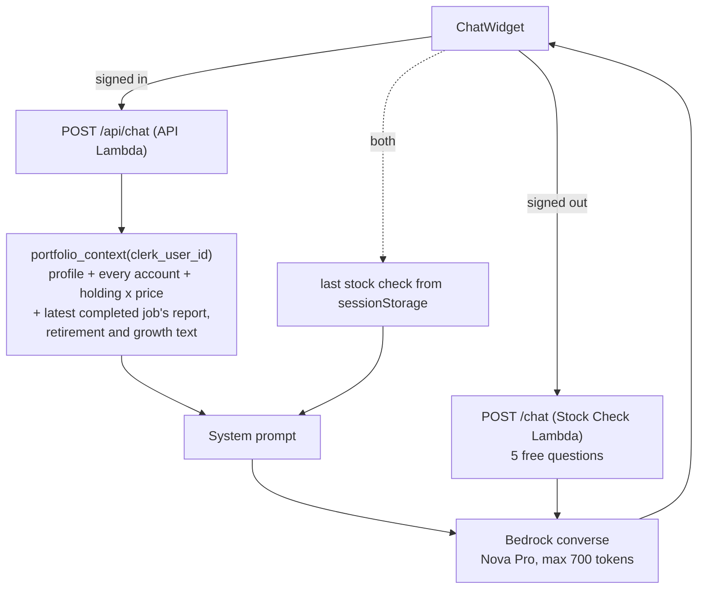

# FinFreedom AI: Complete Project Architecture

This document explains how FinFreedom AI is built and how its pieces connect: the website, the API, the AI agents, the chat assistant, the stock check, the database, and how data ("memory") is saved and updated each time you use the app.

FinFreedom AI started as **Alex**, the capstone project of Ed Donner's "AI in Production" course, and was extended beyond the course. The UI says **FinFreedom AI**. AWS resources, packages and code still use the name `alex`.

---

## 1. The big picture

The app has three independent "lanes":

| Lane | What it does | Login needed? |
|---|---|---|
| **Portfolio app** (CloudFront → API Lambda → Aurora) | Accounts, holdings, FIRE profile, the AI advisor team, signed-in chat | Yes (Clerk) |
| **Agent orchestra** (SQS → Planner → 5 agents) | Runs the full AI analysis of your portfolio in the background | Triggered by the app |
| **Stock Check** (public Lambda URL) | Scores any US or Indian stock with the FinAI engines; free chat | No (3 free checks, 5 free questions) |

A fourth lane, the **research pipeline** (Researcher → Ingest → S3 Vectors), runs on a schedule and builds the knowledge base the Reporter agent searches.

---

## 2. Every component

### Frontend: `frontend/` (Next.js, Pages Router, static export)

| Page | Purpose |
|---|---|
| `index.tsx` | Landing page with the public Stock Check |
| `dashboard.tsx` | Portfolio overview, FIRE calculator, risk assessment (`FinancialProfile.tsx`) |
| `accounts.tsx`, `accounts/[id].tsx` | Accounts and positions; add a position by name ("apple" → AAPL) |
| `advisor-team.tsx` | Starts an analysis and shows the agents working (polls the job) |
| `analysis.tsx` | Results tabs: Report, Charts, Retirement, High Growth Picks |
| `stock-check.tsx` | Full-page stock check (`StockCheck.tsx`, `StockDetails.tsx`) |
| `ChatWidget.tsx` | Floating "Ask FinFreedom AI" chat on every page |

- It is built with `output: 'export'`, so there is no server rendering and no Next API routes. It is plain HTML/JS on S3.
- `trailingSlash: true` produces `dashboard/index.html`. Without it, the S3 website 404s on `/dashboard`.
- `lib/config.ts` points API calls at `http://localhost:8000` locally and at relative `/api/*` in production, which CloudFront forwards to API Gateway.
- `NEXT_PUBLIC_STOCKCHECK_URL` (from `frontend/.env.local`) is the Stock Check Lambda URL.

### API: `backend/api/main.py` (FastAPI on Lambda via Mangum)

Every request carries a Clerk JWT, and `get_current_user_id` turns it into a `clerk_user_id`. All data access is scoped to that ID, which is what keeps each user's data separate.

| Endpoint | Does |
|---|---|
| `GET/PUT /api/user` | Read/save the user, including the `profile` JSONB (FIRE + risk) |
| `GET/POST/PUT/DELETE /api/accounts` | Accounts |
| `GET /api/accounts/{id}/positions`, `POST/PUT/DELETE /api/positions` | Holdings. A new symbol fires the Tagger asynchronously |
| `GET /api/instruments` | Known instruments |
| `POST /api/analyze` | Creates a `jobs` row and sends it to SQS (starts the agents) |
| `GET /api/jobs/{id}`, `GET /api/jobs` | Job status and results (the frontend polls this) |
| `POST /api/chat` | Signed-in chat grounded in your portfolio (section 5) |

### Database: `backend/database/` (Aurora PostgreSQL, RDS Data API)

- It is used as a Python package installed under the module name `src` (`from src import Database`).
- It talks to Aurora only through the **RDS Data API** (HTTPS via boto3), so no VPC or SQL driver is needed.
- On this account (AWS Free plan) the cluster is an **express** cluster created by CLI, not by Terraform. See `notes/knowledge-article.md` §7.

Migrations: `001_schema.sql` runs via `run_migrations.py`. `002_growth_payload.sql` and `003_user_profile.sql` must be applied by hand with `aws rds-data execute-statement`.

### The AI agents: `backend/<agent>/` (OpenAI Agents SDK + LiteLLM → Bedrock)

Each agent is its own Lambda with `lambda_handler.py` (entry point), `agent.py` (agent and tools) and `templates.py` (prompts). They all use `LitellmModel("bedrock/<BEDROCK_MODEL_ID>")`, Nova Pro by default. Because of a LiteLLM + Bedrock limitation, an agent uses **either** tools **or** structured output, never both.

| Agent | Lambda | Style | Reads | Writes |
|---|---|---|---|---|
| **Planner** (orchestrator) | `alex-planner` | Tools: `invoke_reporter`, `invoke_charter`, `invoke_retirement`, `invoke_growth` | Job, portfolio summary | `jobs.status` |
| **Tagger** | `alex-tagger` | Structured output (`InstrumentClassification`) | Unknown symbols | `instruments` (type, region/sector/asset-class %) |
| **Reporter** | `alex-reporter` | Tool: `get_market_insights` (S3 Vectors search) | Portfolio + user + research | `jobs.report_payload` |
| **Charter** | `alex-charter` | No tools, returns chart JSON | Portfolio | `jobs.charts_payload` |
| **Retirement** | `alex-retirement` | No tools | Portfolio + retirement goals | `jobs.retirement_payload` |
| **Growth** (High Growth Value Scout) | `alex-growth` | No tools | Portfolio + `profile.risk_profile` | `jobs.growth_payload` |
| **Researcher** | Lambda container + function URL | Playwright MCP browser + ingest tool | The web | S3 Vectors (through Ingest) |

**Guardrail:** after the Reporter writes, `reporter/judge.py` scores the report with an LLM-as-judge. A score below 0.3 replaces the report with an apology. The judge only runs when LangFuse is configured.

### Stock Check: `backend/stockcheck/` (public container Lambda, `terraform/9_stockcheck`)

| Endpoint | Does |
|---|---|
| `POST /search` | Name → ticker ("infosys" → INFY · NSE) via yfinance Search, US/NSE/BSE stocks and ETFs only |
| `POST /check` | Full analysis of one stock. **Accepts a ticker or a company name:** if the text isn't a listed ticker (or has a space), `resolve_name()` looks it up on the chosen market, preferring NSE for India |
| `POST /chat` | Public chat with Nova Pro via Bedrock `converse` |

How `/check` builds its answer:
1. `fetch_listing`: price history and fundamentals from Yahoo. `IN` tries NSE, then BSE.
2. In parallel: Screener.in (India) or FinViz/Yahoo estimates plus Yahoo ownership (US), and Yahoo analyst ratings, upgrades, events and news.
3. The Node engines copied from the FinAI Streamlit project run: `analysisRunner.js` (fundamental, growth, technical, conviction and risk scores → BUY/HOLD/SELL) and `extrasRunner.js` (projection, moat, sector outlook).
4. It returns one JSON that `StockCheck.tsx` and `StockDetails.tsx` render.

In the UI, typing in the stock check box shows a live dropdown of matching companies from `/search`, filtered to the selected market.

### Research pipeline (Guides 2–4)

- **SageMaker Serverless** endpoint (`all-MiniLM-L6-v2`) turns text into embeddings.
- The **Ingest Lambda** (API Gateway + API key) embeds documents and stores them in **S3 Vectors**.
- The **Researcher** (on an EventBridge schedule, or called by hand) browses the web with Playwright MCP, writes an analysis, and posts it to Ingest.
- The **Reporter** later embeds a query, searches S3 Vectors, and quotes the matching research in your report.

---

## 3. How a full analysis works (Ask the AI Advisor Team)

The Planner only passes a `job_id`, never the data. Each agent loads what it needs from Aurora and writes to **its own column** on the job row, so the agents never overwrite each other and nothing has to be merged. Tagging and price refresh run as plain code before the agent starts, which keeps them fast and deterministic.

---

## 4. How "memory" works: what is saved, where, and when it updates

FinFreedom AI has no hidden vector memory of your conversations. Everything the AI "remembers" about you lives in Aurora and is read fresh on every request.

| What | Stored in | Updated when |
|---|---|---|
| Your profile: retirement years, income goal, FIRE inputs, risk profile | `users` row (`profile` JSONB plus columns) | You save on the dashboard (`PUT /api/user`) |
| Accounts, cash, holdings | `accounts`, `positions` | You add/edit/delete on the Accounts pages |
| What each stock *is* (sector, region, asset class) | `instruments` | The Tagger runs when you add a new symbol, and again before each analysis for anything missing |
| Latest prices | `instruments.current_price` | The Planner refreshes from Polygon at the start of every analysis |
| AI analysis results | `jobs` row: one payload column per agent | Every analysis creates a **new** job row. Old ones are kept as history (`GET /api/jobs`) |
| Market research knowledge | S3 Vectors | Each Researcher run adds documents |
| Chat conversation | Browser only (React state) | Lost on refresh. The server keeps no chat history |
| Last stock check (for chat context) | Browser `sessionStorage` (`alex:lastCheck`) | Each stock check |
| Free-check counter (signed out) | Browser `localStorage` (`alex:freeChecks`) | Each signed-out stock check |

**The update loop:** you change your holdings or profile → run an analysis → agents write a new job → the chat now reads that newer job. Each time you run an analysis, the AI's view of you is refreshed.

---

## 5. How "Ask AI" (the chat) works

There are two chats behind the same `ChatWidget.tsx` bubble:

On each signed-in message, the API:
1. Keeps the last 12 turns of the conversation, which the browser sends each time.
2. Rebuilds `portfolio_context()` from Aurora: your profile, every holding with its current value, and the latest completed analysis from the Reporter, Retirement and Growth agents.
3. Adds the stock you just checked, if any.
4. Calls Bedrock and returns the reply.

Because the context is rebuilt from the database on every message, the chat always reflects your current holdings and newest agent results. That is how it "connects to all the agents": it reads what they wrote.

---

## 6. Infrastructure (Terraform, one independent folder per part)

| Folder | Creates |
|---|---|
| `2_sagemaker` | SageMaker Serverless embedding endpoint |
| `3_ingestion` | S3 Vectors bucket/index, Ingest Lambda, API Gateway + API key |
| `4_researcher` | Researcher container Lambda + function URL, ECR, EventBridge scheduler |
| `5_database` | Secrets Manager secret + Lambda IAM role (it looks up the express Aurora cluster, which is created by CLI) |
| `6_agents` | Planner, Tagger, Reporter, Charter, Retirement, Growth Lambdas; SQS queue; S3 bucket for packages |
| `7_frontend` | S3 website, CloudFront, API Gateway (HTTP API), API Lambda with Aurora, SQS, Lambda-invoke and Bedrock permissions |
| `8_enterprise` | CloudWatch dashboards (AI model usage, agent performance) |
| `9_stockcheck` | Stock Check container Lambda, ECR, public function URL, Bedrock permission |

Each folder has its own local state and `terraform.tfvars`. There are no cross-folder dependencies, so values like ARNs are copied between them by hand.

---

## 7. Deploying changes

| Changed | Run (on your machine) |
|---|---|
| Frontend or API | `cd scripts && uv run deploy.py` |
| An agent | `cd backend && uv run deploy_all_lambdas.py --package` (Docker running) |
| Stock Check | `cd backend/stockcheck && uv run deploy.py` (Docker running) |
| Researcher | `cd backend/researcher && uv run deploy.py` (Docker running) |
| DB schema | `cd backend/database && uv run run_migrations.py` (+ manual 002/003) |

Local development: `cd scripts && uv run run_local.py` (frontend :3000 + API :8000). Test agents with `uv run test_simple.py` (mocked) and `uv run test_full.py` (deployed).

---

## 8. Security and cost notes

- **Auth:** Clerk JWT on every `/api/*` call. Every query filters by `clerk_user_id`, and jobs are checked for ownership.
- **Public surface:** only the Stock Check URL and the Ingest API (API key). The Stock Check's free limits are client-side only.
- **Secrets:** the Aurora password is in Secrets Manager. The Data API uses the secret ARN.
- **Cost:** Aurora is the biggest cost. Lambdas, SQS and SageMaker Serverless cost close to nothing when idle. Destroy what you aren't using and watch the AWS billing page.
