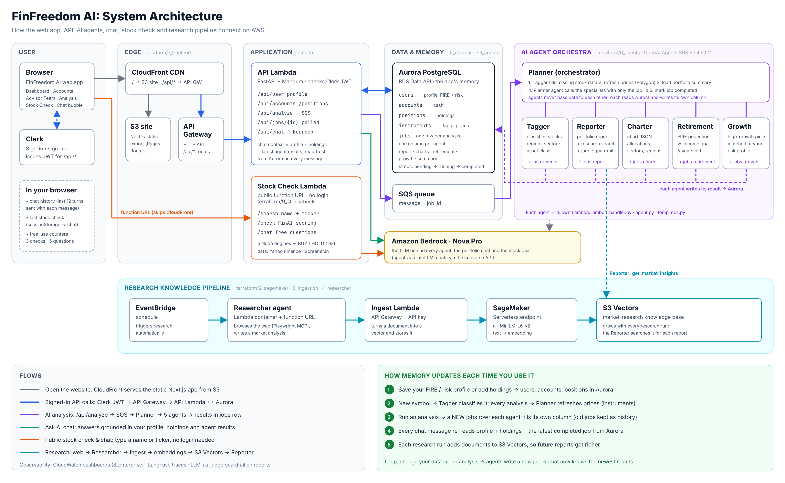

# FinFreedom AI

### Multi-agent, enterprise-grade SaaS financial planner on AWS

**🌐 Live app: [https://d1n70aw5kbc7vt.cloudfront.net](https://d1n70aw5kbc7vt.cloudfront.net)**

Works on desktop and phones. No install needed.

## Try it in 2 minutes

1. **Open the [live app](https://d1n70aw5kbc7vt.cloudfront.net)** and type a stock name or ticker into the free stock check, e.g. `Apple`, `NVDA`, `Infosys` (pick 🇮🇳 India for NSE/BSE). You get a five-pillar score and a BUY / HOLD / SELL call. No account needed: 3 free checks.
2. **Tap "Ask FinFreedom AI"** (bottom right) to have the chat explain the result. 5 free questions.
3. **Sign up free** (email or Google) to unlock everything below.
4. **Accounts →** add your real accounts with one click from the suggested types (see [Account types](#account-types)), then add holdings by company name.
5. **Dashboard →** fill in the FIRE calculator and risk profile.
6. **Advisor Team → Run analysis.** Six AI agents work in parallel and return a report, charts, a retirement projection and growth picks in about a minute. Open **Analysis** to read them, or ask the chat about them.

| Page | Link |
|---|---|
| Home + free stock check | [/](https://d1n70aw5kbc7vt.cloudfront.net/) |
| Stock Check (full research) | [/stock-check](https://d1n70aw5kbc7vt.cloudfront.net/stock-check/) |
| Dashboard (FIRE + risk profile) | [/dashboard](https://d1n70aw5kbc7vt.cloudfront.net/dashboard/) *(sign in)* |
| Accounts | [/accounts](https://d1n70aw5kbc7vt.cloudfront.net/accounts/) *(sign in)* |
| Advisor Team | [/advisor-team](https://d1n70aw5kbc7vt.cloudfront.net/advisor-team/) *(sign in)* |
| Analysis results | [/analysis](https://d1n70aw5kbc7vt.cloudfront.net/analysis/) *(sign in)* |

> FinFreedom AI is for learning and information only. Its AI-generated output has not been vetted by a licensed financial advisor and is not investment advice.

FinFreedom AI looks at your US and Indian stock portfolio with a team of AI agents. It writes a portfolio report, draws charts, projects your retirement / FIRE path, and suggests high-growth ideas that match your risk profile. You can also chat with an assistant that knows your holdings, or check any stock by name or ticker without signing in.

It started as **Alex** (Agentic Learning Equities eXplainer), the Week 3–4 capstone of Ed Donner's *AI in Production* course, and was extended well beyond it. AWS resources and code identifiers still use the name `alex`.

**Full architecture write-up:** [FINFREEDOM_AI_ARCHITECTURE.md](FINFREEDOM_AI_ARCHITECTURE.md). It covers every component, the analysis flow, how the chat is grounded, and what is stored where.

---

## Features

| Feature | What it does |
|---|---|
| **AI Advisor Team** | One click runs the Planner, which orchestrates 5 agents: **Tagger** (classifies holdings), **Reporter** (portfolio report + market research), **Charter** (allocation charts), **Retirement** (FIRE projection) and **Growth** (high-growth picks for your risk profile) |
| **Ask FinFreedom AI** | A chat that answers from your real profile, holdings and the latest agent results |
| **Stock Check** | Score any US or NSE/BSE stock by **company name or ticker** ("Infosys", "Apple", "INFY"), using the FinAI engines: fundamentals, growth, technicals, institutional conviction, risk, moat, projections, analyst ratings and news. Free without an account (3 checks, 5 chat questions) |
| **Portfolio & FIRE profile** | Accounts, positions (added by name), FIRE calculator and risk assessment |
| **Research pipeline** | A scheduled Researcher agent browses the web and builds a vector knowledge base that the Reporter uses |
| **Production practices** | Clerk auth, per-user data isolation, CloudWatch dashboards, LangFuse tracing, LLM-as-judge guardrail |
| **Mobile-friendly UI** | Five-tab phone nav, tables that hide secondary columns, stacked headers, scrollable modals, no iOS input zoom |

## Account types

The Accounts page suggests these as one-click buttons: on the empty state, as a "Suggested accounts to add" strip for types you don't have yet, and as quick picks in the Add Account form. You can also type any custom name.

| Region | Account | Used for |
|---|---|---|
| 🇺🇸 US | 401(k) | Employer retirement account |
| 🇺🇸 US | Roth IRA | Tax-free retirement savings |
| 🇺🇸 US | Traditional IRA | Tax-deferred retirement savings |
| 🇺🇸 US | HSA | Health Savings Account (triple tax advantage) |
| 🇺🇸 US | 529 Plan | Education savings |
| Any | Taxable Brokerage | Long-term investing |
| Any | Emergency Fund | High-yield savings, 3–6 months of expenses |
| 🇮🇳 India | Demat | Indian stocks and ETFs |
| 🇮🇳 India | Mutual Funds / SIP | Monthly SIP investing |
| 🇮🇳 India | EPF | Employee Provident Fund (retirement) |
| 🇮🇳 India | PPF | Public Provident Fund (15-year, tax-free) |
| 🇮🇳 India | NPS | National Pension System (retirement) |

## What's deployed (AWS us-east-1)

| Part | AWS resources | Terraform folder |
|---|---|---|
| Embeddings | SageMaker Serverless endpoint `alex-embedding-endpoint` | `terraform/2_sagemaker` |
| Knowledge base | S3 Vectors + `alex-ingest` Lambda + API Gateway | `terraform/3_ingestion` |
| Researcher | `alex-researcher` Lambda (container) with a function URL (EventBridge schedule optional, not enabled) | `terraform/4_researcher` |
| Database | Aurora PostgreSQL express cluster `alex-aurora-cluster` (Data API) | `terraform/5_database` |
| Agents | `alex-planner`, `-tagger`, `-reporter`, `-charter`, `-retirement`, `-growth` Lambdas + SQS queue and dead-letter queue | `terraform/6_agents` |
| Website + API | S3 + CloudFront (live link above), `alex-api` Lambda (FastAPI) behind API Gateway | `terraform/7_frontend` |
| Stock check + public chat | `alex-stockcheck` Lambda (container) with a public function URL | `terraform/9_stockcheck` |
| Monitoring (optional) | CloudWatch dashboards and alarms (not applied yet) | `terraform/8_enterprise` |

## Tech stack

- **AI:** Amazon Bedrock (Nova Pro), OpenAI Agents SDK + LiteLLM, SageMaker Serverless embeddings, S3 Vectors
- **Backend:** Python (uv), FastAPI on Lambda (Mangum), 6 agent Lambdas + Researcher, SQS, Aurora PostgreSQL (Data API)
- **Stock engines:** yfinance, Screener.in, Node.js scoring engines from the FinAI project
- **Frontend:** Next.js (Pages Router, static export), Tailwind, Clerk, S3 + CloudFront
- **Infra:** Terraform, one independent folder per part (`terraform/2_sagemaker` … `terraform/9_stockcheck`)

## Repository layout

| Folder | Contents |
|---|---|
| `guides/` | Step-by-step deployment guides 1–8 (start here) |
| `backend/` | `api`, `planner`, `tagger`, `reporter`, `charter`, `retirement`, `growth`, `researcher`, `ingest`, `stockcheck`, `database`: each is a uv project |
| `frontend/` | Next.js app |
| `terraform/` | Infrastructure, one folder per part with its own state and `terraform.tfvars` |
| `scripts/` | `run_local.py`, `deploy.py`, `destroy.py` |
| `docs/` | Architecture diagram (PNG + editable SVG) |

## Run and deploy

All Python runs through **uv** (`uv run …`). Docker Desktop must be running for anything that builds a Lambda image or package.

| Task | Run from | Command |
|---|---|---|
| Run frontend (:3000) + API (:8000) locally | `scripts` | `uv run run_local.py` |
| Deploy website + API (build, S3 upload, CloudFront invalidation) | `scripts` | `uv run deploy.py` |
| Deploy Stock Check Lambda | `backend/stockcheck` | `uv run deploy.py` |
| Package + redeploy all agent Lambdas | `backend` | `uv run deploy_all_lambdas.py --package` |
| Deploy Researcher | `backend/researcher` | `uv run deploy.py` |
| Test agents locally / deployed | `backend` | `uv run test_simple.py` / `uv run test_full.py` |
| Database migrations | `backend/database` | `uv run run_migrations.py` |

Configuration comes from the root `.env` (template: `.env.example`), `frontend/.env.local`, and each `terraform/*/terraform.tfvars`.

## Course order of play (original Alex guides)

- **Week 3:** Day 3 `1_permissions`, `2_sagemaker` · Day 4 `3_ingest` · Day 5 `4_researcher`
- **Week 4:** Day 1 `5_database` · Day 2 `6_agents` · Day 3 `7_frontend` · Day 4 `8_enterprise`

## Cost

Aurora is the main running cost. Destroy what you aren't using (`terraform destroy` per folder; see `CLAUDE.md` for the express-cluster steps) and check the AWS billing console regularly.

---

Built on Ed Donner's *AI in Production* course project (Udemy).
