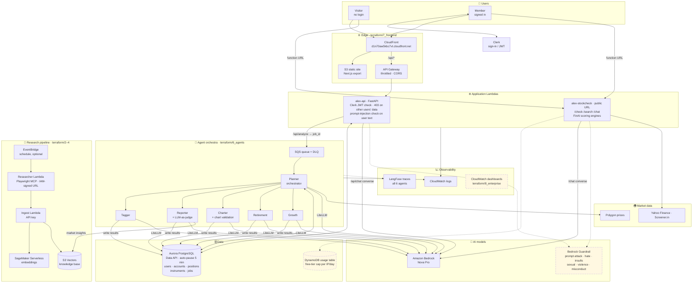

# FinFreedom AI

### Multi-agent, enterprise-grade SaaS financial planner on AWS

**🌐 Live app: [https://d1n70aw5kbc7vt.cloudfront.net](https://d1n70aw5kbc7vt.cloudfront.net)**

Works on desktop and phones. No install needed.

| Link | What it is |
|---|---|
| [Live app](https://d1n70aw5kbc7vt.cloudfront.net) | FinFreedom AI on CloudFront |
| [GitHub repo](https://github.com/SaiSatyaJagannadh/FinanceAToZ-DJ) | This source code |
| [Architecture write-up](FINFREEDOM_AI_ARCHITECTURE.md) | Every component, the analysis flow and the data model |
| [LangFuse (agent traces)](https://us.cloud.langfuse.com) | Prompts, tool calls, tokens and timing for every agent run (project members only) |
| [Deployment guides](guides/) | The 8 step-by-step course guides |
| [FinAI](https://github.com/SaiSatyaJagannadh/FinAI) | Source of the stock scoring engines |

## Try it in 2 minutes

1. **Open the [live app](https://d1n70aw5kbc7vt.cloudfront.net)** and type a stock name or ticker into the free stock check, e.g. `Apple`, `NVDA`, `Infosys` (pick 🇮🇳 India for NSE/BSE). You get a five-pillar score and a BUY / HOLD / SELL call. No account needed: 3 free checks.
2. **Tap "Ask FinFreedom AI"** (bottom right) to have the chat explain the result. 5 free questions.
3. **Sign up free** (email or Google) to unlock everything below.
4. **Accounts →** add your real accounts with one click from the suggested types (see [Account types](#account-types)), then add holdings by company name.
5. **Dashboard →** fill in the FIRE calculator and risk profile.
6. **Advisor Team → Run analysis.** Six AI agents work in parallel and return a report, charts, a retirement projection and growth picks in about a minute. Open **Analysis** to read them, or ask the chat about them.

| Page | Link |
|---|---|
| Home + free stock check | [/](https://d1n70aw5kbc7vt.cloudfront.net/) |
| Stock Check (full research) | [/stock-check](https://d1n70aw5kbc7vt.cloudfront.net/stock-check/) |
| Dashboard (FIRE + risk profile) | [/dashboard](https://d1n70aw5kbc7vt.cloudfront.net/dashboard/) *(sign in)* |
| Accounts | [/accounts](https://d1n70aw5kbc7vt.cloudfront.net/accounts/) *(sign in)* |
| Advisor Team | [/advisor-team](https://d1n70aw5kbc7vt.cloudfront.net/advisor-team/) *(sign in)* |
| Analysis results | [/analysis](https://d1n70aw5kbc7vt.cloudfront.net/analysis/) *(sign in)* |

> FinFreedom AI is for learning and information only. Its AI-generated output has not been vetted by a licensed financial advisor and is not investment advice.


FinFreedom AI looks at your US and Indian stock portfolio with a team of AI agents. It writes a portfolio report, draws charts, projects your retirement / FIRE path, and suggests high-growth ideas that match your risk profile. You can also chat with an assistant that knows your holdings, or check any stock by name or ticker without signing in.

It started as **Alex** (Agentic Learning Equities eXplainer), the Week 3–4 capstone of Ed Donner's *AI in Production* course, and was extended well beyond it. AWS resources and code identifiers still use the name `alex`.

**Full architecture write-up:** [FINFREEDOM_AI_ARCHITECTURE.md](FINFREEDOM_AI_ARCHITECTURE.md). It covers every component, the analysis flow, how the chat is grounded, and what is stored where.

## Complete system diagram

Every part of the SaaS in one view: users, auth, web and API, the agents, data, AI models, research pipeline, observability and guardrails. Dashed boxes are in the code but not deployed yet.



## Project status

FinFreedom AI is a working, multi-user AI SaaS: public landing page and stock check, sign-up, per-user data, a 6-agent analysis pipeline, a grounded chat, observability and cost controls.

| Area | Status |
|---|---|
| Live website + mobile UI | ✅ Live |
| Sign-up / sign-in (Clerk) and per-user data isolation | ✅ Live |
| Accounts, positions by company name, FIRE and risk profile | ✅ Live |
| 6-agent analysis (Planner, Tagger, Reporter, Charter, Retirement, Growth) | ✅ Live, all agents verified end to end |
| Signed-in portfolio chat + public stock check and chat | ✅ Live |
| Research pipeline (Researcher → Ingest → S3 Vectors) | ✅ Live (schedule off) |
| LangFuse tracing + LLM-as-judge on reports | ✅ Live |
| Cost cuts (Aurora auto-pause, WAF removed) | ✅ Done, about $1–5/month for the database |
| Extra guardrails (Bedrock Guardrail, injection checks, chart validation, server-side free cap, IAM on Researcher URL) | 🟡 Code pushed, not deployed. See [Deploying the guardrail changes](#deploying-the-guardrail-changes) |
| CloudWatch dashboards and alarms (`terraform/8_enterprise`) | ⬜ Optional, not applied |

### Where to go next

1. **Use it:** [live app](https://d1n70aw5kbc7vt.cloudfront.net) → sign up → Accounts → Advisor Team → Run analysis → Analysis.
2. **Watch the agents:** [LangFuse](https://us.cloud.langfuse.com) → Tracing → Traces, or `uv run watch_agents.py` in `backend`.
3. **Turn on the extra guardrails:** the 5 steps under [Deploying the guardrail changes](#deploying-the-guardrail-changes) (pay-per-use, under $1/month).
4. **Optional monitoring:** `terraform/8_enterprise` → `terraform apply` for CloudWatch dashboards (see [Guide 8](guides/8_enterprise.md)).
5. **Keep costs low:** check the AWS billing console; `terraform destroy` anything you stop using (see [Cost](#cost)).

---

## Features

| Feature | What it does |
|---|---|
| **AI Advisor Team** | One click runs the Planner, which orchestrates 5 agents: **Tagger** (classifies holdings), **Reporter** (portfolio report + market research), **Charter** (allocation charts), **Retirement** (FIRE projection) and **Growth** (high-growth picks for your risk profile) |
| **Ask FinFreedom AI** | A chat that answers from your real profile, holdings and the latest agent results |
| **Stock Check** | Score any US or NSE/BSE stock by **company name or ticker** ("Infosys", "Apple", "INFY"), using the FinAI engines: fundamentals, growth, technicals, institutional conviction, risk, moat, projections, analyst ratings and news. Free without an account (3 checks, 5 chat questions) |
| **Portfolio & FIRE profile** | Accounts, positions (added by name), FIRE calculator and risk assessment |
| **Research pipeline** | A scheduled Researcher agent browses the web and builds a vector knowledge base that the Reporter uses |
| **Production practices** | Clerk auth, per-user data isolation, structured CloudWatch logs, LangFuse tracing on every agent, LLM-as-judge on reports, plus the guardrails and security listed under [Guardrails and security](#guardrails-and-security) |
| **Mobile-friendly UI** | Five-tab phone nav, tables that hide secondary columns, stacked headers, scrollable modals, no iOS input zoom |

## Account types

The Accounts page suggests these as one-click buttons: on the empty state, as a "Suggested accounts to add" strip for types you don't have yet, and as quick picks in the Add Account form. You can also type any custom name.

| Region | Account | Used for |
|---|---|---|
| 🇺🇸 US | 401(k) | Employer retirement account |
| 🇺🇸 US | Roth IRA | Tax-free retirement savings |
| 🇺🇸 US | Traditional IRA | Tax-deferred retirement savings |
| 🇺🇸 US | HSA | Health Savings Account (triple tax advantage) |
| 🇺🇸 US | 529 Plan | Education savings |
| Any | Taxable Brokerage | Long-term investing |
| Any | Emergency Fund | High-yield savings, 3–6 months of expenses |
| 🇮🇳 India | Demat | Indian stocks and ETFs |
| 🇮🇳 India | Mutual Funds / SIP | Monthly SIP investing |
| 🇮🇳 India | EPF | Employee Provident Fund (retirement) |
| 🇮🇳 India | PPF | Public Provident Fund (15-year, tax-free) |
| 🇮🇳 India | NPS | National Pension System (retirement) |

## What's deployed (AWS us-east-1)

| Part | AWS resources | Terraform folder |
|---|---|---|
| Embeddings | SageMaker Serverless endpoint `alex-embedding-endpoint` | `terraform/2_sagemaker` |
| Knowledge base | S3 Vectors + `alex-ingest` Lambda + API Gateway | `terraform/3_ingestion` |
| Researcher | `alex-researcher` Lambda (container) with a function URL (EventBridge schedule optional, not enabled) | `terraform/4_researcher` |
| Database | Aurora PostgreSQL express cluster `alex-aurora-cluster` (Data API) | `terraform/5_database` |
| Agents | `alex-planner`, `-tagger`, `-reporter`, `-charter`, `-retirement`, `-growth` Lambdas + SQS queue and dead-letter queue | `terraform/6_agents` |
| Website + API | S3 + CloudFront (live link above), `alex-api` Lambda (FastAPI) behind API Gateway | `terraform/7_frontend` |
| Stock check + public chat | `alex-stockcheck` Lambda (container) with a public function URL | `terraform/9_stockcheck` |
| Observability | LangFuse Cloud (US) tracing for all 6 agents, keys passed as Lambda env vars | `terraform/6_agents` (`terraform.tfvars`) |
| Monitoring (optional) | CloudWatch dashboards and alarms (not applied yet) | `terraform/8_enterprise` |

## Observability with LangFuse

Every agent Lambda wraps its run in `observe()` (`backend/<agent>/observability.py`). Logfire instruments the OpenAI Agents SDK and sends each run to LangFuse as a trace, flushing before the Lambda returns.

**View traces:** sign in at **[https://us.cloud.langfuse.com](https://us.cloud.langfuse.com)** → your project → **Tracing → Traces**. Filter by service name (`alex_planner_agent`, `alex_reporter_agent`, `alex_charter_agent`, `alex_retirement_agent`, `alex_growth_agent`, `alex_tagger_agent`) and open a trace to see the exact prompts, model responses, tool calls, token usage and timing.

**Set it up:** add the keys to `terraform/6_agents/terraform.tfvars`. That file is gitignored, so the keys never reach GitHub. Every line needs `=`; a line like `langfuse_host"…"` fails with `Invalid block definition`.

```hcl
langfuse_public_key = "pk-lf-..."
langfuse_secret_key = "sk-lf-..."
langfuse_host       = "https://us.cloud.langfuse.com"
openai_api_key      = "sk-..."   # needed for trace export even though the models run on Bedrock
```

Then deploy and watch:

| Step | Run from | Command |
|---|---|---|
| Package and deploy the agents with the keys | `backend` | `uv run deploy_all_lambdas.py --package` |
| Deploy the app | `scripts` | `uv run deploy.py` |
| Run an analysis (or click **Run analysis** on the site) | `backend` | `uv run test_full.py` |
| Tail all agents' logs live | `backend` | `uv run watch_agents.py` |

In CloudWatch, a working setup logs `LangFuse authentication check passed` and `Traces flushed successfully`.

With LangFuse on, the Reporter's LLM-as-judge (`backend/reporter/judge.py`) also runs on each report and replaces any report that scores below 0.3. Uploading the judge's score to LangFuse currently logs `Failed to process score event … 'ProxyTracerProvider' object has no attribute 'sampler'`, a clash between the Langfuse SDK and Logfire tracing libraries. The judge still runs and traces still export.

## Guardrails and security

✅ = live now. 🟡 = in the code (commits `3210efb`–`7bd64ce`) but **not deployed yet**; see [Deploying the guardrail changes](#deploying-the-guardrail-changes).

| Area | Protection | Where | Status |
|---|---|---|---|
| Auth | Clerk sign-in token checked on every `/api/*` route | `backend/api/main.py` | ✅ |
| Data isolation | Accounts, positions and jobs return 403 unless they belong to the signed-in user | `backend/api/main.py` | ✅ |
| API abuse | API Gateway throttling, 100 requests/s; CORS limited to the site | `terraform/7_frontend` | ✅ |
| Secrets | Keys only in gitignored `terraform.tfvars` / `.env` and Lambda env vars; none in git | | ✅ |
| Rate limits | Retry with exponential backoff (tenacity) on Bedrock rate limits in every agent | `backend/<agent>/` | ✅ |
| Report quality | LLM-as-judge replaces reports that score below 0.3 (runs when LangFuse is on) | `backend/reporter/judge.py` | ✅ |
| Tagger output | Pydantic validation: allocations must sum to 100% | `backend/tagger/agent.py` | ✅ |
| Chat size | Message length and turn caps on both chats | `backend/api/main.py`, `backend/stockcheck/handler.py` | ✅ |
| Prompt injection in user text | Account names/purposes, position names and display name that look like AI instructions are rejected (400) | `backend/database/src/guardrails.py`, `backend/api/main.py` | 🟡 |
| Chat safety | **Amazon Bedrock Guardrail**: prompt-attack (jailbreak/injection) filter on the user's message, plus hate, insults, sexual, violence and misconduct filters on input and output, for both chats | `terraform/9_stockcheck` (`alex-chat-guardrail`) | 🟡 |
| Chart output | Charter drops malformed charts (must be a known type with `{name, value}` points) | `backend/charter/lambda_handler.py` | 🟡 |
| Output size | Report, retirement and growth text capped at 50,000 characters | `src/guardrails.py` `truncate_response` | 🟡 |
| Free-tier abuse | Server-side cap per visitor IP per day (60 checks, 60 chat messages; HTTP 429 after), counted in DynamoDB. Today the "3 free checks" is only browser-side | `backend/stockcheck/handler.py`, `alex-stockcheck-usage` table | 🟡 |
| Researcher endpoint | Function URL switched from public to AWS IAM auth; `test_research.py` and the scheduler sign requests (SigV4) | `terraform/4_researcher` | 🟡 |
| WAF | Not used. Not needed at this scale (about $8/month); see Guide 8 to add one | | ➖ |

Self-checks: `uv run -m src.guardrails` and `uv run test_resume_retry.py` (both in `backend/database`).

### Deploying the guardrail changes

Run in this order, with Docker Desktop running:

1. `backend/stockcheck` → `uv run deploy.py`. This creates the Bedrock Guardrail and the usage table, and updates the stock check Lambda.
2. `terraform/9_stockcheck` → `terraform output chat_guardrail_id chat_guardrail_version`. Copy both values into `terraform/7_frontend/terraform.tfvars` as `chat_guardrail_id` and `chat_guardrail_version`.
3. `backend` → `uv run deploy_all_lambdas.py --package` (agents).
4. `scripts` → `uv run deploy.py` (API with the injection checks and the chat guardrail).
5. `terraform/4_researcher` → `terraform apply` (Researcher URL to IAM auth).

## Tech stack

- **AI:** Amazon Bedrock (Nova Pro), OpenAI Agents SDK + LiteLLM, SageMaker Serverless embeddings, S3 Vectors
- **Backend:** Python (uv), FastAPI on Lambda (Mangum), 6 agent Lambdas + Researcher, SQS, Aurora PostgreSQL (Data API)
- **Stock engines:** yfinance, Screener.in, Node.js scoring engines from the FinAI project
- **Frontend:** Next.js (Pages Router, static export), Tailwind, Clerk, S3 + CloudFront
- **Infra:** Terraform, one independent folder per part (`terraform/2_sagemaker` … `terraform/9_stockcheck`)

## Repository layout

| Folder | Contents |
|---|---|
| `guides/` | Step-by-step deployment guides 1–8 (start here) |
| `backend/` | `api`, `planner`, `tagger`, `reporter`, `charter`, `retirement`, `growth`, `researcher`, `ingest`, `stockcheck`, `database`: each is a uv project |
| `frontend/` | Next.js app |
| `terraform/` | Infrastructure, one folder per part with its own state and `terraform.tfvars` |
| `scripts/` | `run_local.py`, `deploy.py`, `destroy.py` |
| `docs/` | Architecture diagram (PNG + editable SVG) |

## Run and deploy

All Python runs through **uv** (`uv run …`). Docker Desktop must be running for anything that builds a Lambda image or package.

| Task | Run from | Command |
|---|---|---|
| Run frontend (:3000) + API (:8000) locally | `scripts` | `uv run run_local.py` |
| Deploy website + API (build, S3 upload, CloudFront invalidation) | `scripts` | `uv run deploy.py` |
| Deploy Stock Check Lambda | `backend/stockcheck` | `uv run deploy.py` |
| Package + redeploy all agent Lambdas | `backend` | `uv run deploy_all_lambdas.py --package` |
| Deploy Researcher | `backend/researcher` | `uv run deploy.py` |
| Test agents locally / deployed | `backend` | `uv run test_simple.py` / `uv run test_full.py` |
| Database migrations | `backend/database` | `uv run run_migrations.py` |

Configuration comes from the root `.env` (template: `.env.example`), `frontend/.env.local`, and each `terraform/*/terraform.tfvars`.

## Course progress (original Alex guides)

| Week / Day | Guide | Status |
|---|---|---|
| Week 3 · Day 3 | [1 Permissions](guides/1_permissions.md) | ✅ Done |
| Week 3 · Day 3 | [2 SageMaker embeddings](guides/2_sagemaker.md) | ✅ Deployed |
| Week 3 · Day 4 | [3 Ingestion + S3 Vectors](guides/3_ingest.md) | ✅ Deployed |
| Week 3 · Day 5 | [4 Researcher](guides/4_researcher.md) | ✅ Deployed (schedule not enabled) |
| Week 4 · Day 1 | [5 Database](guides/5_database.md) | ✅ Deployed (express cluster, auto-pause) |
| Week 4 · Day 2 | [6 Agent orchestra](guides/6_agents.md) | ✅ Deployed (+ Growth agent) |
| Week 4 · Day 3 | [7 Frontend + API](guides/7_frontend.md) | ✅ [Live](https://d1n70aw5kbc7vt.cloudfront.net) |
| Week 4 · Day 4 | [8 Enterprise](guides/8_enterprise.md) | 🟡 LangFuse observability done ([traces](https://us.cloud.langfuse.com)); CloudWatch dashboards/alarms (`terraform/8_enterprise`) not applied |
| Beyond the course | Stock check + public chat | ✅ Deployed (`terraform/9_stockcheck`) |

## Cost

Aurora **auto-pauses** after 5 idle minutes (Serverless v2 `MinCapacity=0`, `SecondsUntilAutoPause=300`), so an idle app costs almost nothing. That's about $1–5/month instead of about $44/month at the old 0.5 ACU minimum. The first request after a pause waits about 15 seconds while Aurora resumes. `backend/database/src/client.py` retries `DatabaseResumingException`, so users see a slow first load, not an error. No WAF is used. Everything else (Lambda, SageMaker Serverless, S3, CloudFront) is pay-per-use. The guardrail changes add no always-on cost: the Bedrock Guardrail is billed per text unit (about $0.0002 per chat message), and the DynamoDB usage table is pay-per-request with TTL cleanup. At this app's traffic that is well under $1/month.

To change the pause setting:

```bash
aws rds modify-db-cluster --db-cluster-identifier alex-aurora-cluster --apply-immediately \
  --serverless-v2-scaling-configuration MinCapacity=0,MaxCapacity=1,SecondsUntilAutoPause=300
```

Destroy what you aren't using (`terraform destroy` per folder; see `CLAUDE.md` for the express-cluster steps) and check the AWS billing console regularly.

---

Built on Ed Donner's *AI in Production* course project (Udemy).
